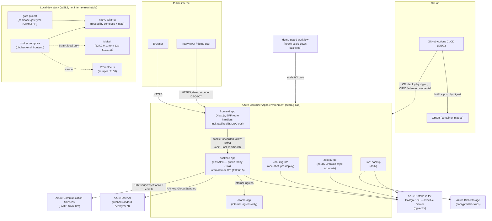

# SecRAG — Threat model and vulnerability catalogue

> Phase 12 (12a — `docs/adr/adr_phase12_security_baseline.md` once written in 12.2.7)
> introduces this document. It is kept current by every later phase that touches a trust
> boundary, adds a route, or closes a catalogue entry — see each entry's **Phase** and
> **Test ID** columns.

## 1. Scope and method

STRIDE (Spoofing, Tampering, Repudiation, Information disclosure, Denial of service,
Elevation of privilege) per trust boundary, then a vulnerability catalogue cross-referencing
three public lists — OWASP Top 10:2025 (web application risks), OWASP API Security Top
10:2023, and the OWASP Top 10 for LLM Applications 2025 — with SecRAG's own code-review
findings (F1–F11, found 2026-09-26) folded into the matching entries. Every catalogue entry
carries: **status** (`mitigated` / `planned` / `accepted`), **defence difficulty** (how hard
the control is to build), **attack level** (how hard the attack is to pull off against this
app today), **assigned phase**, and a **test ID** — a `path::test_function` that proves a
`mitigated` entry, or the future task that will close a `planned` one. The `threat-catalogue`
gate step (§6) enforces that every entry has a phase and a test ID, and that every
`mitigated` entry's test ID resolves to a real, existing test.

This document stays at the level of controls and verification — no exploit payloads, no
working proof-of-concept code, no secret values (DEFINITION_OF_DONE.md "Universal norms").

## 2. Data-flow diagram

Reflects the architecture as of Phase 11c (standard Container Apps environment `secrag-cae`,
ADR 11 decision 10) plus the local development stack.

## 3. Trust boundaries

| ID | Boundary | Crosses from → to | Notes |
|---|---|---|---|
| TB1 | Public internet ↔ frontend/BFF | Browser / Interviewer → `frontend` app | Only boundary exposed to anonymous traffic. CSRF, CSP, cookie, rate-limit and auth controls concentrate here. |
| TB2 | BFF ↔ backend | `frontend` route handlers → `backend` app | Same Container Apps environment; backend reachable by its in-environment name (`BACKEND_URL`) regardless of ingress visibility (12a public, 12b internal). Cookie forwarded; the legacy Bearer rollback path (12a only) was removed entirely in 12b (T12.5.3) — cookie authentication is the only path left. |
| TB3 | Backend ↔ Postgres | `backend` / Jobs → Flexible Server | TLS required; least-privilege DB roles (app/purger/backup/retention) per migration grants (X4); firewall allows Azure-internal traffic (DEBT-016, accepted risk, §5.4). |
| TB4 | Backend ↔ Ollama | `backend` → `ollama` app (internal ingress only) / native Ollama locally | Never internet-reachable; no authentication layer of its own — relies on network isolation. |
| TB5 | Backend ↔ Azure OpenAI | `backend` → Azure OpenAI GlobalStandard endpoint | API-key auth; GlobalStandard means prompts may be processed outside the EU (DEBT-020, accepted risk, §5.4). |
| TB6 | Backend ↔ Azure Communication Services | `backend` → ACS SMTP (from 12b) | Carries verification/reset links and the recipient's email address; abuse limits planned T12.4.8. |
| TB7 | CI/CD ↔ Azure | GitHub Actions → GHCR / Container Apps / Jobs | OIDC federated credential (no stored cloud secret); images deployed by digest; `secrag/gate-full` status gates `main` deploys. |
| TB8 | demo-guard ↔ Azure | Scheduled workflow → Container Apps | Scale-down only (`test_the_script_can_never_scale_up`); backstop for the manual demo-mode window (DEBT-011/030, §5.4). |
| TB9 | Local dev stack | WSL2 host only | Lower trust requirements by design (not internet-reachable); still shares code with prod paths, so dev-only bypasses are fail-closed (`ENV=prod` guard, `test_env_guard.py`). |

## 4. STRIDE per trust boundary

Existing controls are already merged/tested on `main`; planned controls name the task that
adds them. `DEC-005/006/007` are the three Phase-12 decisions the user ratified 2026-10-16.

### TB1 — Public internet ↔ frontend/BFF

| STRIDE | Threat | Existing control | Planned control |
|---|---|---|---|
| Spoofing | Session/credential theft via XSS exfiltrating a `localStorage` token (F1) | Password hashing (`test_password_roundtrip`), JWT signature/expiry checks; `__Host-` cookie + `HttpOnly` session (T12.1.3, `backend/tests/security/test_auth_cookies.py::test_logout_makes_the_cookie_fail_server_side`), CSRF double-submit (T12.1.4, `backend/tests/security/test_csrf.py`), nonce CSP enforcing with zero violations (T12.2.2/T12.2.3, `frontend/e2e/security-headers.spec.ts`) | — |
| Tampering | CSRF on state-changing routes | Signed double-submit token, `Origin` check (T12.1.4, `backend/tests/security/test_csrf.py::test_logout_with_a_valid_csrf_token_succeeds` et al.) | — |
| Repudiation | No record of who acted when sessions aren't server-tracked | Server-side `sessions` table (migration 0006, T12.1.1, `backend/tests/security/test_sessions.py`) | `audit_events` (15.3) |
| Information disclosure | `/docs`, `/redoc`, `/openapi.json` public (F7); CORS `*` methods/headers (F8) | Docs gated to `ENV=dev` (T12.2.4); CORS narrowed in 12a, then **removed entirely** in 12b (T12.5.3, `backend/tests/test_security_headers.py::test_cors_is_removed_entirely_even_for_the_frontends_own_origin`) — the BFF-based frontend never triggers a browser CORS preflight at all | — |
| Denial of service | Anonymous chat cost (daily cap already mitigates, §5.5); on Azure every request arrives from the same internal address today, so per-IP limiting is defeated (F4). **Caveat (DA-12aC-2, DEBT-034):** `login:<email>:<ip>` keying only closes to a per-account bucket once a caller actually goes through the BFF and signs its IP; a request reaching the public backend directly (still possible until 12b's internal ingress) falls back to the shared Azure connection address, collapsing the key to `login:<email>` only — targeted per-account login throttling, not worse than the old pure-IP keying, accepted until 12b | Daily answer cap (`test_the_default_cap_is_on_and_valid_in_prod`); per-IP/account rate limits keyed by the signed client IP (F4, T12.1.6, `backend/tests/security/test_client_ip.py::test_rate_limit_login_is_keyed_by_account_not_only_ip`) | Fully closes (the DEBT-034 caveat above) only once the backend is unreachable except via the BFF (12b) |
| Elevation of privilege | No roles today (F6) | `users.role` column exists (migration 0006); deny-by-default role -> permission map (`rag_app.authz`, T12.3.2/T12.3.2b), admin bootstrap CLI is the only writer of `role` (T12.3.3), admin routes additionally require a fresh MFA step-up (T12.3.4/T12.3.5); client-tampering suite (mass assignment, header/query tricks, cookie tampering, direct calls, missing step-up) run as a role x route matrix generated from the permission map (T12.3.6, `backend/tests/security/test_client_tampering.py`) | — |

**Decision-driven (DEC-005/DEC-006):** `/api/health` added to the BFF allow-list (T12.1.5,
`frontend/app/api/health/route.ts`); `cd.yml`'s post-deploy check and `demo-mode.sh on` now
poll it instead of a backend FQDN (T12.5.6, 2026-11-12 — `backend/tests/test_cd_pipeline.py::
test_backend_health_check_goes_through_the_frontends_bff_not_its_own_fqdn`,
`backend/tests/test_demo_mode.py::test_on_health_checks_through_the_frontends_bff_not_a_backend_fqdn`)
so both keep working once the backend's own FQDN stops being reachable from the internet
(12b, T12.6b.5); the private smoke tools (`rag_ia/tools/smoke.py`) still need the same
change — orchestrator item, T12.5.6. BFF upstream/SSE timeouts set to **≥ 240 s** (T12.1.5)
so the 11b cold-start fix (170 s embed wait under Azure's ingress limit) is not silently
shortened by the new frontend hop.

### TB2 — BFF ↔ backend

| STRIDE | Threat | Existing control | Planned control |
|---|---|---|---|
| Spoofing | Backend trusting a forged client-IP header, or every request on Azure sharing the same internal address (F4). **Caveat:** closes fully only once the backend is unreachable except via the BFF (12b, DEBT-034) — until then a request straight to the backend's public URL still gets the shared address | HMAC-signed `X-SecRAG-Client-IP`, 300 s window (widened from 30 s in T12.3.0a/DEBT-038 — a cold start could outlast 30 s and silently degrade to the connection address), fallback + a `result`-labelled security event on failure (verified/fallback/stale/forged — `backend/tests/security/test_client_ip.py::test_missing_forged_or_stale_signature_falls_back_and_records_the_right_result`) | — |
| Tampering | BFF silently mutating or dropping the SSE stream | Explicit allow-list route handlers, unbuffered SSE (T12.1.5, `frontend/lib/bffRoutes.test.ts`); real-browser proof a genuinely slow, multi-chunk, Ollama-backed stream survives the whole path (`frontend/e2e/auth.spec.ts`, DEBT-035, proven 2026-10-17: a real security-question chat turn took ~9.9 s end to end) | — |
| Information disclosure | BFF exposing `/metrics` or `/docs` by accident | Allow-list never includes them (`frontend/lib/bffRoutes.test.ts`, "never /metrics, /docs, /redoc or /openapi.json, whatever the method") | — |
| Denial of service | Slow/blocked upstream cut early by a short BFF timeout, defeating the 11b cold-start fix | BFF timeouts ≥ 240 s, keep-alive pings pass through (T12.1.5, DEC-006, `frontend/lib/bffProxy.test.ts`) | 1 fully-cold chat question smoke on Azure (T12.6a.5, 12a-P) |

### TB3 — Backend ↔ Postgres

| STRIDE | Threat | Existing control | Planned control |
|---|---|---|---|
| Tampering | SQL injection | ORM/parameterised queries (`test_malicious_title_round_trips_verbatim`) | — |
| Information disclosure | Bound parameters/PII leaking into error logs | `test_database_errors_never_render_bound_parameters`, `test_log_hygiene.py` suite | Audit log pseudonymised IPs (15.3) |
| Elevation of privilege | App role granted more than it needs | Per-role grants, no superuser (`test_roles_are_not_superusers_and_have_only_their_mapped_rights`) | Restricted role everywhere locally + audit append-only role (15.3.7) |
| (accepted) | Firewall allows any Azure tenant's traffic (DEBT-016) | TLS required, long random passwords, least privilege | Network hardening decision at 15.0 |

### TB4 — Backend ↔ Ollama

| STRIDE | Threat | Existing control | Planned control |
|---|---|---|---|
| Spoofing/Tampering | Another workload on the same environment reaching the model server | Internal ingress only (no public FQDN) | NetworkPolicies once on k8s (16.4) |
| Denial of service | Unbounded concurrent reranker/generation calls | App-level concurrency cap (2) — accepted gap, no autoscaling (DEBT-010, §5.4) | KEDA-based autoscaling (16.3) |

### TB5 — Backend ↔ Azure OpenAI

| STRIDE | Threat | Existing control | Planned control |
|---|---|---|---|
| Information disclosure | Prompts processed outside the EU (GlobalStandard, no DataZoneStandard quota) | Accepted risk, disclosed in README/PRD privacy notes (DEBT-020, §5.4) | Quota re-check at 14.0 and 15.4 |
| Denial of service | Unbounded token usage / cost | `max_tokens` on every call (`test_every_llm_call_in_the_code_passes_max_tokens`), daily answer cap | Daily token budget table shared with workers (15.4.6) |
| Tampering | Malformed/unexpected API response shape | Strict response parsing (`test_parse_azure_chat_response_rejects_missing_choices` et al.) | — |

### TB6 — Backend ↔ Azure Communication Services (12b)

| STRIDE | Threat | Existing control | Planned control |
|---|---|---|---|
| Information disclosure | Verification link returned in the API response or logged (F9) | Log line removed (11a, T11.2.15); link removed from the response entirely, Mailpit locally (12a, T12.1.11, `test_resend_never_returns_a_verification_link`) | Real SMTP send (ACS) in 12b |
| Denial of service | Email bombing via register/resend/forgot | — | Per-IP/recipient/global abuse limits (T12.4.8) |

### TB7 — CI/CD ↔ Azure

| STRIDE | Threat | Existing control | Planned control |
|---|---|---|---|
| Spoofing | Long-lived cloud credential leaking from CI | OIDC federated credential only, no stored secret | — |
| Tampering | Deploying an unsigned/unexpected image | Deploy by digest; `secrag/gate-full` status required | Keyless signing + digest verification (15.5.5) |
| Repudiation | No trace of which SHA is live | `secrag/gate-full` posted per SHA; CD records a GitHub deployment | — |

### TB8 — demo-guard ↔ Azure (accepted risk, §5.4)

| STRIDE | Threat | Existing control | Planned control |
|---|---|---|---|
| Denial of service (cost) | Demo window left on past its 3 h budget | Hourly `demo-guard` workflow, scale-down only (`test_the_script_can_never_scale_up`) | None — GitHub's `schedule` trigger can lag hours (DEBT-011/030); accepted, re-checked at each phase close |

### TB9 — Local dev stack

| STRIDE | Threat | Existing control | Planned control |
|---|---|---|---|
| Elevation of privilege | A dev-only flag (fake LLM provider, defence lab, …) reaching `ENV=prod` | Fail-closed env guard (`test_api_lifespan_refuses_to_start_with_a_dev_flag_in_prod`) | Same pattern applied to each new dev-only feature (16.3.3, 13.3.1, 19, 20) |

## 5. Vulnerability catalogue

Columns: **ID**, **Entry**, **Status** (`mitigated` / `planned` / `accepted`), **Defence
difficulty**, **Attack level**, **Phase**, **Test ID**, **Notes** (folds in F1–F11 and plain
tracking IDs like `DEBT-020`, never a private file name — `private-names`).

<!-- threat-catalogue:begin -->

### 5.1 OWASP Top 10:2025 (web application)

| ID | Entry | Status | Defence difficulty | Attack level | Phase | Test ID | Notes |
|---|---|---|---|---|---|---|---|
| OWASP-A01 | Broken Access Control | planned | medium | low | 15.1 | T15.1.1 | Object-level ownership already enforced on conversations (`backend/tests/test_chat_stream.py::test_someone_elses_conversation_is_a_404_before_streaming`); systematic generated-ownership suite + function-level checks in 15.1. F6 (no roles) closes in 12a/12b. |
| OWASP-A02 | Security Misconfiguration | mitigated | low | low | 12a | backend/tests/test_frontend_csp_mode.py::test_csp_mode_is_enforce_not_report_only | F2 (no security headers), F7 (`/docs` public), F8 (CORS `*` methods/headers) all closed. Backend half (F7/F8) proven by `pytest` — see API-8. Frontend half (headers + nonce CSP, F2) proven in a real browser by `frontend/e2e/security-headers.spec.ts` (`security-headers` gate step, 12a-E phase 2, 2026-10-17): every page served HSTS/nosniff/Referrer-Policy/Permissions-Policy and triggered zero violations with `CSP_MODE` (`frontend/lib/csp.ts`) `"enforce"` (T12.2.3's literal Done-when). The cited Test ID is a fast Python regression guard on `CSP_MODE` itself (`threat-catalogue` requires a `.py` test ID for a `mitigated` row) — the real browser proof is the Playwright spec, not Python-testable. |
| OWASP-A03 | Software Supply Chain Failures | mitigated | medium | medium | 11a | backend/tests/test_devtools.py::test_the_repository_exceptions_file_is_valid | `dependency-audit` gate step + gitleaks baseline; hardened further with SBOM/signing/Trivy/CodeQL in 15.5. |
| OWASP-A04 | Cryptographic Failures | mitigated | medium | high | 11a | backend/tests/test_crypto.py::test_wrong_key_cannot_decrypt | At-rest encryption + key wrap/unwrap; TLS required to Postgres (reachability is a separate accepted risk, DEBT-016). |
| OWASP-A05 | Injection | mitigated | low | high | 1 | backend/tests/test_chat_stream.py::test_a_hostile_title_round_trips_through_postgres_unexecuted | ORM/parameterised queries throughout; a `DROP TABLE`-shaped title is written via the real rename endpoint into the real Postgres database and read back unchanged, with the table and row still present. |
| OWASP-A06 | Insecure Design | planned | high | low | 12a | T12.0.5 | This document and its gate step are the control: every design decision (P12-D1…D4) is written down and checked against a catalogue entry before being considered done. |
| OWASP-A07 | Authentication Failures | mitigated | medium | medium | 12b | backend/tests/test_security.py::test_login_timing_does_not_distinguish_a_real_account_from_a_missing_one | **F1 closed in 12a** (JWT no longer in `localStorage` — grepped, zero hits; server-side logout: `backend/tests/security/test_auth_cookies.py::test_logout_makes_the_cookie_fail_server_side`). **F3 closed in 12b-B** (T12.4.1: a generic 202 on register whatever the outcome — `rag_app.api.auth.register`, never a 409 — AND the same cost paid either way: no upfront existence check, the argon2 hash and the same attempted DB writes run unconditionally, discarded by a rollback on the unique-index conflict rather than detected in advance by a cheaper read (DA-12bB-1 fix) — `backend/tests/security/test_register_timing.py::test_register_timing_does_not_distinguish_an_existing_account_from_a_new_one`; constant-time login — `rag_app.security.dummy_password_hash`, same test as the Test ID column). **F10 closed in 12b-B** (T12.4.3: `rag_app.password_policy` — length, email-local-part, NCSC/SecLists breach list — `backend/tests/test_password_policy.py`). |
| OWASP-A08 | Software or Data Integrity Failures | planned | high | low | 15.5 | T15.5.5 | Keyless signing + digest verification; corpus integrity hash manifest (15.4.5). |
| OWASP-A09 | Logging & Alerting Failures | mitigated | low | medium | 11a | backend/tests/test_log_hygiene.py::test_the_whole_auth_flow_logs_no_email_or_token | No PII/secrets in logs across the whole auth flow. F9 (verification link logged) already removed (11a). Dashboard banner alerts (the "alerting" half) planned 13.5.2. |
| OWASP-A10 | Mishandling of Exceptional Conditions | mitigated | medium | medium | 11a | backend/tests/test_daily_cap.py::test_stream_fails_closed_when_the_counter_cannot_be_written | Fail-closed on counter/storage failures rather than granting a free answer; the same pattern is reviewed for every new data store the project adds. |

### 5.2 OWASP API Security Top 10:2023

| ID | Entry | Status | Defence difficulty | Attack level | Phase | Test ID | Notes |
|---|---|---|---|---|---|---|---|
| API-1 | Broken Object Level Authorization | mitigated | medium | medium | 11a | backend/tests/test_chat_stream.py::test_someone_elses_conversation_is_a_404_before_streaming | A second user's conversation ID is a 404, not a 403 (no existence leak). |
| API-2 | Broken Authentication | mitigated | medium | medium | 12b | backend/tests/test_security.py::test_login_timing_does_not_distinguish_a_real_account_from_a_missing_one | F1 closed in 12a, F3/F10 closed in 12b-B — see OWASP-A07. |
| API-3 | Broken Object Property Level Authorization | planned | low | low | 15.1 | T15.1.3 | `extra="forbid"` everywhere (mass assignment, e.g. setting `role`). |
| API-4 | Unrestricted Resource Consumption | mitigated | medium | medium | 11a | backend/tests/test_daily_cap.py::test_chat_at_the_cap_is_a_429_with_retry_after_and_no_llm_call | Global daily answer cap, no LLM call once reached. Rerank concurrency cap without autoscaling is a documented accepted gap until 16.3 (DEBT-010, §5.4). |
| API-5 | Broken Function Level Authorization | mitigated | medium | low | 12b | backend/tests/security/test_client_tampering.py::test_the_permission_map_matrix_covers_every_protected_route | F6 closed: deny-by-default role -> permission map (`rag_app.authz.require_permission`, T12.3.2b) resolves every protected route (never a role-string comparison); fails closed on a permission unknown to the map; role never writable from any API route (admin bootstrap CLI only, T12.3.3); admin routes also require a fresh MFA step-up (T12.3.5). The matrix test is generated from the live route registry, not a hand-maintained list. |
| API-6 | Unrestricted Access to Sensitive Business Flows | mitigated | medium | medium | 12b | backend/tests/security/test_lockout.py::test_the_next_failure_past_the_threshold_locks_and_back_off_grows | F5 closed (T12.4.2: exponential-back-off lockout, `rag_app.lockout`, REC-05). F11 closed (T12.4.4: `require_email_verification` defaults on with `ENV=prod`; login refuses an unverified account — `backend/tests/security/test_mfa.py` fixtures exercise the generic register/login contract this depends on). |
| API-7 | Server Side Request Forgery | planned | low | low | 13.1 | T13.1.1 | No endpoint fetches a user-supplied URL server-side today; the route walker (T12.5.2, `backend/tests/security/test_route_walker.py`, mitigated as API-5/REC-08) already proves every route's full dependency set, which would make a future URL-fetching endpoint without its own SSRF guard immediately visible in review, not just by this entry's own (still planned) test. |
| API-8 | Security Misconfiguration | mitigated | low | low | 12b | backend/tests/test_security_headers.py::test_docs_routes_are_404_with_env_prod | F7 (`/docs`/`/redoc`/`/openapi.json` gated to `ENV=dev`) and F8 (CORS narrowed to the old frontend's exact needs in 12a, **removed entirely** in 12b, T12.5.3 — `test_cors_is_removed_entirely_even_for_the_frontends_own_origin`/`test_cors_is_removed_entirely_for_a_foreign_origin_too`) both close here, provable without a browser (`pytest`, T12.2.4/T12.5.3's own gate). The frontend-header half of this entry's original scope is OWASP-A02 (now also mitigated, 12a-E phase 2 — real-browser Playwright proof). |
| API-9 | Improper Inventory Management | planned | low | low | 13.0 | T13.0.3 | The feature registry becomes the authoritative route/feature inventory. |
| API-10 | Unsafe Consumption of APIs | mitigated | medium | low | 11a | backend/tests/test_llm_bounds.py::test_every_llm_call_in_the_code_passes_max_tokens | Only two pinned upstream APIs (Ollama, Azure OpenAI); responses schema-validated (`test_parse_azure_chat_response_rejects_missing_choices`), every call bounded. |

### 5.3 OWASP Top 10 for LLM Applications 2025

| ID | Entry | Status | Defence difficulty | Attack level | Phase | Test ID | Notes |
|---|---|---|---|---|---|---|---|
| LLM-01 | Prompt Injection | planned | high | medium | 15.4 | T15.4.1 | Today the user's question is the only free-text LLM input; retrieved chunks, the conversation summary and the router's inputs are not yet wrapped as explicitly untrusted data (closes in 14.2/15.4). |
| LLM-02 | Sensitive Information Disclosure | planned | medium | medium | 15.4 | T15.4.2 | Canary token (leak detection) planned; logging already keeps PII/secrets out (`test_log_hygiene.py`). |
| LLM-03 | Supply Chain | mitigated | medium | medium | 11a | backend/tests/test_devtools.py::test_the_repository_exceptions_file_is_valid | Same control as OWASP-A03 — model/dependency pinning + dependency audit. |
| LLM-04 | Data and Model Poisoning | planned | high | low | 15.4 | T15.4.5 | Corpus hash manifest verified at index time. |
| LLM-05 | Improper Output Handling | planned | low | low | 15.4 | T15.4.3 | Output is already plain text with citation markers (no HTML/markdown execution); allow-listed corpus-source links formalised in 15.4.3. |
| LLM-06 | Excessive Agency | planned | medium | low | 17 | T17.pre.1 | No agentic tool execution with side effects exists yet; revisited when MCP tools are added in Phase 17. |
| LLM-07 | System Prompt Leakage | planned | medium | medium | 14.4 | T14.4.3 | Stage events never carry the system prompt or raw prompts (14.4.1); canary-style test for prompt fragments (14.4.3). |
| LLM-08 | Vector and Embedding Weaknesses | mitigated | medium | medium | 11a | backend/tests/test_db_roles.py::test_roles_are_not_superusers_and_have_only_their_mapped_rights | The pgvector store lives in Postgres behind the same least-privilege role grants; corpus poisoning detection (hash manifest) planned 15.4.5. |
| LLM-09 | Misinformation | mitigated | high | low | 4 | backend/tests/test_eval.py::test_abstaining_on_answerable_counts_as_incorrect | Faithfulness/correctness/correct-abstention floors enforced by the `eval` gate step; an incorrect abstention counts against the metric. |
| LLM-10 | Unbounded Consumption | mitigated | medium | medium | 11a | backend/tests/test_llm_bounds.py::test_every_llm_call_in_the_code_passes_max_tokens | `max_tokens` bound on every call + daily answer cap. Rerank concurrency cap without autoscaling is the same accepted gap as API-4 (DEBT-010, §5.4). |

### 5.4 Accepted risks

Decided by the user, re-checked at the stated phase; `DEBT-0xx` are plain tracking IDs, not a
file name.

| ID | Entry | Status | Defence difficulty | Attack level | Phase | Test ID | Notes |
|---|---|---|---|---|---|---|---|
| RISK-01 | Azure OpenAI GlobalStandard data residency (prompts may be processed outside the EU; DataZoneStandard quota is 0 in every EU region) | accepted | n/a | n/a | accepted (re-check 14.0, 15.4) | DEBT-020 | Disclosed in the README/PRD privacy notes (added when those docs are touched, T12.2.7/T12.5.4). |
| RISK-02 | PostgreSQL firewall rule `AllowAllAzureServicesAndResourcesWithinAzureIps` (reachable from any Azure tenant; password + TLS are the only protection) | accepted | medium | low | decide at 15.0 | DEBT-016 | No VNet in the standard Container Apps environment; mitigated by long random passwords, least-privilege roles, required TLS. |
| RISK-03 | Rerank concurrency cap (2) without autoscaling — queueing under load | accepted | medium | low | 16.3 (KEDA) | DEBT-010 | Max 1 replica by budget; documented in ADR 11. |
| RISK-04 | Demo mode keeps apps at `min 1` while on; `demo-guard`'s hourly schedule can lag up to ~5 h (GitHub `schedule` trigger, not real-time) | accepted | n/a | n/a | accepted (reviewed every phase close) | DEBT-011, DEBT-030 | Cost-bounded; backstop only scales down, never up (`test_the_script_can_never_scale_up`). |

### 5.5 Recorded design/control items

Not deferred risks — controls already in place, recorded here because they were explicitly
named for this catalogue (Phase 12 re-check, W3).

**X10 — No TOCTOU (cross-cutting project rule X10, 2026-11-09).** A
state-dependent decision backed by the database is never a SELECT to check the state
followed by a separate UPDATE (a classic check-then-use race: two concurrent callers can
both read the "not yet used/not yet locked out/still valid" state before either writes,
and both then act on it). Instead it is ONE atomic statement whose `WHERE` clause encodes
the check — `UPDATE … WHERE <condition> RETURNING`, or an equivalent single-statement
claim — so that under Postgres' normal (READ COMMITTED) concurrency, a second caller's
statement either finds nothing left to match (the first already committed the state
change) or blocks briefly on the row lock and then finds nothing to match once it runs.
**Template, written first here (T12.3.5):** `rag_app.api.admin.claim_recovery_code` —
`UPDATE mfa_recovery_codes SET used_at = now() WHERE user_id = :uid AND code_hash = :hash
AND used_at IS NULL`, proved single-use under genuine thread concurrency (not just two
sequential HTTP calls) by
`backend/tests/security/test_mfa.py::test_concurrent_claims_of_the_same_recovery_code_let_exactly_one_through`.
12b-B's lockout counters (T12.4.2, below, REC-05) and 12b-C's reset/verify token consume
(T12.4.6, below, REC-06) follow the exact same shape: the counter/consume update's
`WHERE`/`ON CONFLICT` clause IS the check, never a prior SELECT.

**DEBT-034 design note (12b-B, does not close DEBT-034 — it closes at T12.6b.5).**
`rag_app.lockout` keys the counter by `HMAC(LOCKOUT_HMAC_SECRET, email)`, not by `user_id`
(F5/API-6: an attempt against an email that is not even registered is throttled exactly
like a real account, so the lockout mechanism itself cannot be used as an existence
oracle). Exponential back-off (free attempts up to `LOCKOUT_THRESHOLD`, then growing,
capped at `LOCKOUT_MAX_SECONDS`) plus a reset after `LOCKOUT_RESET_AFTER_SECONDS` of
silence bounds how long a THIRD PARTY can keep ONE victim account locked out — it does
**not**, by itself, stop a third party flooding MANY different accounts' counters from the
SAME shared Azure address, because the public backend URL has no signed real IP yet
(DA-12aC-2, accepted until 12b). `rag_app.api.deps.rate_limit_login` already adds the
real-IP axis (keyed by email + IP) as a second, independent defence today. DEBT-034 itself
is accepted until the backend ingress goes internal (T12.6b.5), which removes the
shared-address problem — not ticked here.

**Email abuse recipient backstop design note (12b-C fix block, DA-12bC-1/DEC-026 = A,
2026-11-12).** `rag_app.email_abuse.EmailAbuseLimiter` (T12.4.8) originally had one
recipient-wide bucket shared across every source IP: a single attacker IP trickling
requests at just under its refill rate could keep a victim's address permanently drained
(well under the per-IP/global caps, so neither ever engaged), silently suppressing the
victim's own forgot-password/resend-verification emails indefinitely — the same class of
gap as the DEBT-034 note above, just never written down for this feature. The fix adds a
fourth bucket keyed on `(recipient, requester IP)` (`_RECIPIENT_IP_CAPACITY` = 3/hour); the
pure-recipient bucket is kept as the backstop against a MANY-IP flood (defence in depth from
the original design) and is raised to `_RECIPIENT_CAPACITY` = 20/hour — deliberately
**larger** than what any single IP can ever draw through its own `(recipient, IP)` bucket
(20 > 3), and with a refill rate (20/hour) well above the 3/hour ceiling one attacker IP is
held to, so the backstop never runs dry from one source alone: the victim's own request from
a DIFFERENT IP is never blocked by that attacker (`backend/tests/test_email_abuse.py::
test_single_attacker_ip_trickling_never_starves_the_victim_from_another_ip`). A coordinated
**many-IP** flood (enough distinct attacker IPs, each staying under its own 3/hour
`(recipient, IP)` cap) can still exhaust the 20/hour backstop — this residual risk is
**accepted**, the same mitigation layering DEBT-034 already accepts for login lockout (a
second, independent real-IP axis closes the single-actor case; only a shared store across
every source address would close the many-IP case, out of scope for a single backend
replica — see the single-replica note right below). Proved still working as a defence by
`backend/tests/test_email_abuse.py::test_many_ip_flood_still_hits_the_recipient_backstop`.
The recipient identity itself is HMACed with a random per-process salt before it is ever used
as a bucket key (`backend/tests/test_email_abuse.py::
test_recipient_bucket_keys_never_contain_the_raw_email`) — never the raw email in memory or
in any log line built from one.

**Single-replica limitation (DA-12bC-3).** `EmailAbuseLimiter`'s buckets, like every other
in-memory limiter in this family (`rag_app.ratelimit.RateLimiter`, the chat rate limiter;
`rag_app.risk.SignupTracker`), live in ONE process's memory — correct only while the backend
runs a single replica, exactly the constraint RISK-03/DEBT-010 (§5.4 below) already documents
for the reranker concurrency cap. Multi-replica support (16.3, KEDA autoscaling) must back
this whole family with a shared store (e.g. Redis) before the backend can run more than one
replica; this is not a new gap, just the same one restated for a second subsystem.

| ID | Entry | Status | Defence difficulty | Attack level | Phase | Test ID | Notes |
|---|---|---|---|---|---|---|---|
| REC-01 | Internal metrics port (9100) never served on the API port or exposed by any Container Apps ingress | mitigated | low | low | 11a | backend/tests/test_metrics.py::test_api_port_never_serves_metrics | Separate port, scraped only by the local Prometheus; no Azure ingress rule maps to it. |
| REC-02 | Daily answer cap / per-request rate limits (R6-1) | mitigated | low | medium | 11a | backend/tests/test_daily_cap.py::test_the_default_cap_is_on_and_valid_in_prod | On by default and required positive in `ENV=prod`. |
| REC-03 | Crypto-shred erasure (per-user data key destroyed on account deletion) | mitigated | high | low | 6/11a | backend/tests/test_key_recovery.py::test_erase_end_to_end_through_the_app_erasure_path | Makes the user's encrypted rows permanently unreadable even where a backup copy still exists; restores replay tombstones (`replay_deletions`). |
| REC-04 | X10 no-TOCTOU: recovery-code single-use is one atomic `UPDATE … WHERE used_at IS NULL`, never SELECT-then-UPDATE | mitigated | medium | low | 12b | backend/tests/security/test_mfa.py::test_concurrent_claims_of_the_same_recovery_code_let_exactly_one_through | `rag_app.api.admin.claim_recovery_code`, proved single-use under 8-thread `threading.Barrier` concurrency at the DB level. Verified to fail/flake against a temporarily-reverted naive SELECT-then-UPDATE (1 failure / 30 runs, about 3.3%) vs. 0 failures / 10 runs on the atomic version — never committed, DA-12bA-3 fix block. **Companion test (DA-12bA2-1):** `backend/tests/security/test_mfa.py::test_claim_recovery_code_is_a_single_atomic_statement` is a deterministic structural check (inspects the function's own source for one `session.execute(update(...))` call, no `select`/`session.query`/`session.get`), added because the concurrency test alone is only ~3.3% likely to catch a regression to SELECT-then-UPDATE — listed here (not in the Test ID cell, which the `threat-catalogue` gate step resolves as exactly one `path::test_function`) so a future reader (12b-B/C) knows it exists and why. Template for 12b-B's lockout counters (T12.4.2) and 12b-C's reset/verify token consume (T12.4.6). |
| REC-05 | X10 no-TOCTOU: login lockout counter is one atomic `INSERT … ON CONFLICT … DO UPDATE`, never SELECT-then-UPDATE | mitigated | medium | medium | 12b | backend/tests/security/test_lockout.py::test_concurrent_failed_logins_against_the_same_key_lose_no_updates | `rag_app.lockout.record_failed_login`, proved lossless under 8-thread `threading.Barrier` concurrency (the final counter equals the thread count — a lost update would make it lower). **Companion test:** `backend/tests/security/test_lockout.py::test_record_failed_login_is_a_single_atomic_statement` is the same deterministic structural check as REC-04's (exactly one `session.execute`, the SQL is an `INSERT … ON CONFLICT … DO UPDATE SET`, no `select`/`session.query`). See the DEBT-034 design note above (X10 prose) for what this does and does not defend against. |
| REC-06 | X10 no-TOCTOU: email-verification and password-reset token consume are each one atomic `UPDATE … WHERE used_at IS NULL AND expires_at > now()`, never SELECT-then-UPDATE | mitigated | medium | low | 12b | backend/tests/security/test_password_reset.py::test_concurrent_resets_with_the_same_token_let_exactly_one_through | `rag_app.api.auth._consume_password_reset_token`/`_consume_email_verification_token` (T12.4.6 DA re-check), proved single-use under 8-thread `threading.Barrier` concurrency at the DB level, same REC-04 template. **Companion tests (deterministic structural checks):** `backend/tests/security/test_password_reset.py::test_consume_password_reset_token_is_a_single_atomic_statement` and `::test_consume_email_verification_token_is_a_single_atomic_statement` (exactly one `session.execute`, the SQL is the atomic conditional `UPDATE`, no `select`/`session.query` inside the function). Success (`/auth/reset`) also revokes every session of the account and clears any login lockout — proved by `test_reset_password_success_revokes_sessions_and_clears_the_lockout`. |
| REC-07 | Email abuse recipient backstop cannot be starved by a single trickling attacker IP (DA-12bC-1/DEC-026 = A) | mitigated | medium | low | 12b | backend/tests/test_email_abuse.py::test_single_attacker_ip_trickling_never_starves_the_victim_from_another_ip | `rag_app.email_abuse.EmailAbuseLimiter`'s new `(recipient, IP)` bucket caps one source IP's share of a recipient's traffic well below the pure-recipient backstop's capacity/refill rate (see the design note above for the exact numbers/arithmetic). **Companion tests:** `backend/tests/test_email_abuse.py::test_many_ip_flood_still_hits_the_recipient_backstop` (the accepted many-IP residual still works as a defence) and `::test_recipient_bucket_keys_never_contain_the_raw_email` (HMAC, no raw email in the in-memory key). |
| REC-08 | Route walker: every route declares auth + a permission (T12.3.2b, never a role string) + a rate limit, or is on a closed public allow-list (T12.5.2, user idea 2026-11-09, DEC-023) | mitigated | medium | low | 12b | backend/tests/security/test_route_walker.py::test_every_route_declares_auth_and_permission_and_a_rate_limit_or_is_public | Walks the real app's full recursive dependency tree (`rag_app.authz.DECLARED_PERMISSION_ROUTES`, `rag_app.api.deps.RATE_LIMIT_DEPENDENCIES`). **Companion tests** prove the rule itself has teeth, not just passes trivially: `::test_an_undeclared_route_fails_the_walker` (a toy route with none of the three) and `::test_a_route_with_only_auth_still_fails_for_the_missing_permission_and_rate_limit` (a partial fix still fails). Closed the existing gap where `/chat`, `/chat/stream`, `/conversations*`, `/auth/me`, `DELETE /account` and the MFA enrol/confirm/step-up routes had auth but no declared permission and, for most of them, no rate limit at all — new `rag_app.api.deps.rate_limit_account` factory. |
| REC-09 | The frontend's public URL never serves a repo/config file with real content: `/.git/HEAD`, `/.git/config`, `/.env`, `/.env.local`, a `.next/` server file, a `*.map` source map, `/backend/`, `/docker-compose.yml` (T12.5.7, user idea 2026-11-09, DEC-023) | mitigated | low | low | 12b | backend/tests/security/test_exposed_files.py::test_the_backend_never_serves_any_of_these_paths | The backend has no static file serving at all — checked unconditionally, no DB needed. The reusable smoke helper (`scripts/azure/exposed_files_check.sh`, for the Azure smoke T12.6b.6 and local use) has its own pass/fail logic proven against a throwaway HTTP server: `::test_the_helper_passes_when_nothing_is_exposed`, `::test_the_helper_fails_closed_when_one_path_is_exposed`, `::test_the_helper_fails_closed_when_every_path_is_exposed`, `::test_the_helper_never_prints_a_response_body`. |
| REC-10 | Post-deploy and demo-mode health checks go through the frontend's own `/api/health` BFF route, never a backend-specific FQDN (DEC-005/T12.5.6, 2026-11-12) | mitigated | low | low | 12b | backend/tests/test_cd_pipeline.py::test_backend_health_check_goes_through_the_frontends_bff_not_its_own_fqdn | The backend will have no public URL to poll directly at all once ingress goes internal (T12.6b.5). **Companion test:** `backend/tests/test_demo_mode.py::test_on_health_checks_through_the_frontends_bff_not_a_backend_fqdn` (same proof for `scripts/azure/demo-mode.sh on`). The private smoke tools (`rag_ia/tools/smoke.py`) still hardcode the backend's FQDN — orchestrator item, not covered by either test above. |

<!-- threat-catalogue:end -->

## 6. The `threat-catalogue` gate step

`scripts/gate.sh --only threat-catalogue` runs
`python -m rag_app.devtools.threat_catalogue` against this file:

- Every table row between the `threat-catalogue:begin`/`:end` markers must have a non-empty
  **Phase** and **Test ID** — a row missing either fails the step.
- `Status` must be one of `mitigated`, `planned`, `accepted`.
- A `mitigated` row's **Test ID** must be a `path::test_function` that resolves to a real,
  tracked test file containing that function — an entry claiming to be mitigated by a test
  that does not exist fails the step (this is the regression test for a catalogue that drifts
  from the code).
- `planned` and `accepted` rows may use a future task ID (e.g. `T15.1.1`) or a plain tracking
  ID (e.g. `DEBT-020`) instead, since there is no test to point at yet.

## 7. Azure read-only checks (T12.0.6)

Read-only `curl` against the live Azure URLs, no auth, no writes, no LLM calls. Results
recorded 2026-10-16.

- [x] `curl -I` on the frontend's `/` and `/login`: both `200`; **no security headers** (no
  HSTS, CSP, nosniff, `Referrer-Policy`, `Permissions-Policy`, `frame-ancestors`); `X-Powered-By:
  Next.js` present. Confirms F2 (OWASP-A02, API-8), closes in 12.2.
- [x] `curl -I` on the backend's `/health`: `200`. `/docs`, `/redoc`, `/openapi.json`: all `200`
  **publicly reachable**. Confirms F7 (OWASP-A02, API-8), closes in 12.2. `Server: uvicorn`
  header present (informational). `/metrics` on the API port: `404` — metrics are only served on
  the internal port (REC-01), as expected.
- [x] CORS preflight (`Origin: https://evil.example` → `/auth/login`): `400` — the foreign
  origin itself is rejected, but the response still advertises
  `Access-Control-Allow-Methods: DELETE, GET, HEAD, OPTIONS, PATCH, POST, PUT, QUERY` and echoes
  the requested headers. Confirms F8 (methods/headers still wide open even though the origin is
  narrowed): 12a narrows further, 12b removes CORS entirely (T12.5.3, code-complete
  2026-11-12 — `backend/tests/test_security_headers.py`; re-verified live on Azure at the
  12b promotion smoke, T12.6b.6).
- [x] F9 behaviour on the deployed backend: by code review (the resend-verification endpoint
  only returns the verification link when `ENV=dev`) and the production replica's `ENV=prod`
  (already verified in 11a), the deployed backend does **not** return the link in its response.
  The dev-only code path itself is removed once Mailpit lands locally (12a, T12.1.11).
- [ ] ACS managed-domain send quota: **not checked** — no ACS resource exists yet (it is created
  in 12b). To verify during the 12.6b pre-merge; Azure-managed domains have low default daily
  send limits, and the 12b Azure smoke already budgets for ≤ 3 emails.

No catalogue entry's status changes as a result of these checks — OWASP-A02/API-8 (F2/F7/F8)
and OWASP-A09 (F9) were already `planned` for the phase/task shown above, and these checks
confirm exactly the gap each is meant to close, nothing new or already-closed.
