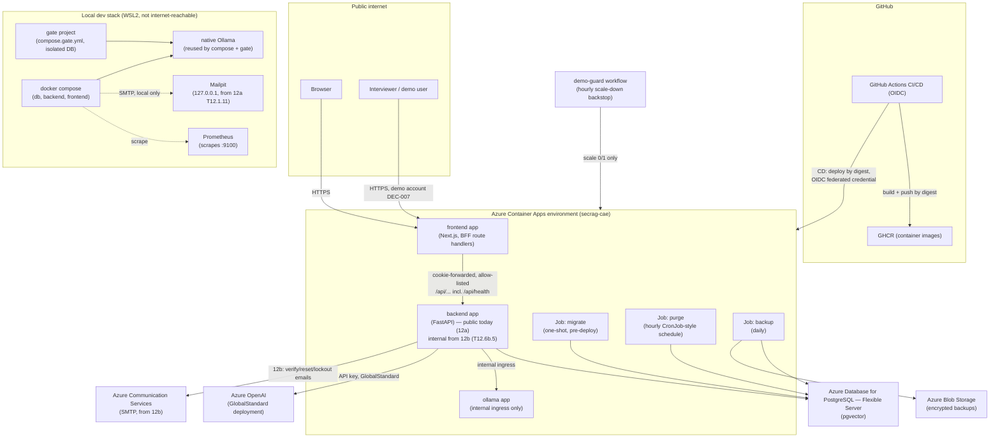

# SecRAG — Threat model and vulnerability catalogue

> Phase 12 (12a — `docs/adr/adr_phase12_security_baseline.md` once written in 12.2.7)
> introduces this document. It is kept current by every later phase that touches a trust
> boundary, adds a route, or closes a catalogue entry — see each entry's **Phase** and
> **Test ID** columns.

## 1. Scope and method

STRIDE (Spoofing, Tampering, Repudiation, Information disclosure, Denial of service,
Elevation of privilege) per trust boundary, then a vulnerability catalogue cross-referencing
three public lists — OWASP Top 10:2025 (web application risks), OWASP API Security Top
10:2023, and the OWASP Top 10 for LLM Applications 2025 — with SecRAG's own code-review
findings (F1–F11, found 2026-09-26) folded into the matching entries. Every catalogue entry
carries: **status** (`mitigated` / `planned` / `accepted`), **defence difficulty** (how hard
the control is to build), **attack level** (how hard the attack is to pull off against this
app today), **assigned phase**, and a **test ID** — a `path::test_function` that proves a
`mitigated` entry, or the future task that will close a `planned` one. The `threat-catalogue`
gate step (§6) enforces that every entry has a phase and a test ID, and that every
`mitigated` entry's test ID resolves to a real, existing test.

This document stays at the level of controls and verification — no exploit payloads, no
working proof-of-concept code, no secret values (DEFINITION_OF_DONE.md "Universal norms").

## 2. Data-flow diagram

Reflects the architecture as of Phase 11c (standard Container Apps environment `secrag-cae`,
ADR 11 decision 10) plus the local development stack.

## 3. Trust boundaries

| ID | Boundary | Crosses from → to | Notes |
|---|---|---|---|
| TB1 | Public internet ↔ frontend/BFF | Browser / Interviewer → `frontend` app | Only boundary exposed to anonymous traffic. CSRF, CSP, cookie, rate-limit and auth controls concentrate here. |
| TB2 | BFF ↔ backend | `frontend` route handlers → `backend` app | Same Container Apps environment; backend reachable by its in-environment name (`BACKEND_URL`) regardless of ingress visibility (12a public, 12b internal). Cookie forwarded; legacy Bearer accepted only in 12a (rollback path). |
| TB3 | Backend ↔ Postgres | `backend` / Jobs → Flexible Server | TLS required; least-privilege DB roles (app/purger/backup/retention) per migration grants (X4); firewall allows Azure-internal traffic (DEBT-016, accepted risk, §5.4). |
| TB4 | Backend ↔ Ollama | `backend` → `ollama` app (internal ingress only) / native Ollama locally | Never internet-reachable; no authentication layer of its own — relies on network isolation. |
| TB5 | Backend ↔ Azure OpenAI | `backend` → Azure OpenAI GlobalStandard endpoint | API-key auth; GlobalStandard means prompts may be processed outside the EU (DEBT-020, accepted risk, §5.4). |
| TB6 | Backend ↔ Azure Communication Services | `backend` → ACS SMTP (from 12b) | Carries verification/reset links and the recipient's email address; abuse limits planned T12.4.8. |
| TB7 | CI/CD ↔ Azure | GitHub Actions → GHCR / Container Apps / Jobs | OIDC federated credential (no stored cloud secret); images deployed by digest; `secrag/gate-full` status gates `main` deploys. |
| TB8 | demo-guard ↔ Azure | Scheduled workflow → Container Apps | Scale-down only (`test_the_script_can_never_scale_up`); backstop for the manual demo-mode window (DEBT-011/030, §5.4). |
| TB9 | Local dev stack | WSL2 host only | Lower trust requirements by design (not internet-reachable); still shares code with prod paths, so dev-only bypasses are fail-closed (`ENV=prod` guard, `test_env_guard.py`). |

## 4. STRIDE per trust boundary

Existing controls are already merged/tested on `main`; planned controls name the task that
adds them. `DEC-005/006/007` are the three Phase-12 decisions the user ratified 2026-10-16.

### TB1 — Public internet ↔ frontend/BFF

| STRIDE | Threat | Existing control | Planned control |
|---|---|---|---|
| Spoofing | Session/credential theft via XSS exfiltrating a `localStorage` token (F1) | Password hashing (`test_password_roundtrip`), JWT signature/expiry checks | `__Host-` cookie, `HttpOnly`, CSRF double-submit (T12.1.3/T12.1.4), CSP nonce (T12.2.2) |
| Tampering | CSRF on state-changing routes | — | Signed double-submit token, `Origin` check (T12.1.4) |
| Repudiation | No record of who acted when sessions aren't server-tracked | — | Server-side `sessions` table (migration 0006, T12.1.1); `audit_events` (15.3) |
| Information disclosure | `/docs`, `/redoc`, `/openapi.json` public (F7); CORS `*` methods/headers (F8) | — | Docs gated to `ENV=dev` (T12.2.4), CORS narrowed (T12.2.4) then removed (12b T12.5.3) |
| Denial of service | Anonymous chat cost (daily cap already mitigates, §5.5) | Daily answer cap (`test_the_default_cap_is_on_and_valid_in_prod`) | Per-IP/account rate limits keyed by signed client IP (T12.1.6) |
| Elevation of privilege | No roles today (F6) | — | `users.role`, `require_role` (12a/12b, T12.3.2) |

**Planned, decision-driven (DEC-005/DEC-006):** `/api/health` added to the BFF allow-list
(T12.1.5) so `cd.yml`'s post-deploy check, `demo-mode.sh on` and the smoke tools keep working
once the backend's own FQDN stops being reachable from the internet (12b, T12.6b.5); BFF
upstream/SSE timeouts set to **≥ 240 s** (T12.1.5) so the 11b cold-start fix (170 s embed wait
under Azure's ingress limit) is not silently shortened by the new frontend hop.

### TB2 — BFF ↔ backend

| STRIDE | Threat | Existing control | Planned control |
|---|---|---|---|
| Spoofing | Backend trusting a forged client-IP header | — | HMAC-signed `X-SecRAG-Client-IP`, 30 s window, fallback + security event on failure (T12.1.6) |
| Tampering | BFF silently mutating or dropping the SSE stream | — | Explicit allow-list route handlers, unbuffered SSE (T12.1.5); `e2e` Playwright proof |
| Information disclosure | BFF exposing `/metrics` or `/docs` by accident | — | Allow-list never includes them (T12.1.5 Done-when) |
| Denial of service | Slow/blocked upstream cut early by a short BFF timeout, defeating the 11b cold-start fix | — | BFF timeouts ≥ 240 s, keep-alive pings pass through (T12.1.5, DEC-006); 1 fully-cold chat question smoke (T12.6a.5) |

### TB3 — Backend ↔ Postgres

| STRIDE | Threat | Existing control | Planned control |
|---|---|---|---|
| Tampering | SQL injection | ORM/parameterised queries (`test_malicious_title_round_trips_verbatim`) | — |
| Information disclosure | Bound parameters/PII leaking into error logs | `test_database_errors_never_render_bound_parameters`, `test_log_hygiene.py` suite | Audit log pseudonymised IPs (15.3) |
| Elevation of privilege | App role granted more than it needs | Per-role grants, no superuser (`test_roles_are_not_superusers_and_have_only_their_mapped_rights`) | Restricted role everywhere locally + audit append-only role (15.3.7) |
| (accepted) | Firewall allows any Azure tenant's traffic (DEBT-016) | TLS required, long random passwords, least privilege | Network hardening decision at 15.0 |

### TB4 — Backend ↔ Ollama

| STRIDE | Threat | Existing control | Planned control |
|---|---|---|---|
| Spoofing/Tampering | Another workload on the same environment reaching the model server | Internal ingress only (no public FQDN) | NetworkPolicies once on k8s (16.4) |
| Denial of service | Unbounded concurrent reranker/generation calls | App-level concurrency cap (2) — accepted gap, no autoscaling (DEBT-010, §5.4) | KEDA-based autoscaling (16.3) |

### TB5 — Backend ↔ Azure OpenAI

| STRIDE | Threat | Existing control | Planned control |
|---|---|---|---|
| Information disclosure | Prompts processed outside the EU (GlobalStandard, no DataZoneStandard quota) | Accepted risk, disclosed in README/PRD privacy notes (DEBT-020, §5.4) | Quota re-check at 14.0 and 15.4 |
| Denial of service | Unbounded token usage / cost | `max_tokens` on every call (`test_every_llm_call_in_the_code_passes_max_tokens`), daily answer cap | Daily token budget table shared with workers (15.4.6) |
| Tampering | Malformed/unexpected API response shape | Strict response parsing (`test_parse_azure_chat_response_rejects_missing_choices` et al.) | — |

### TB6 — Backend ↔ Azure Communication Services (12b)

| STRIDE | Threat | Existing control | Planned control |
|---|---|---|---|
| Information disclosure | Verification link returned in the API response or logged (F9) | Log line already removed (11a, T11.2.15) | Link removed from the response entirely once Mailpit lands (12a, T12.1.11); real SMTP send in 12b |
| Denial of service | Email bombing via register/resend/forgot | — | Per-IP/recipient/global abuse limits (T12.4.8) |

### TB7 — CI/CD ↔ Azure

| STRIDE | Threat | Existing control | Planned control |
|---|---|---|---|
| Spoofing | Long-lived cloud credential leaking from CI | OIDC federated credential only, no stored secret | — |
| Tampering | Deploying an unsigned/unexpected image | Deploy by digest; `secrag/gate-full` status required | Keyless signing + digest verification (15.5.5) |
| Repudiation | No trace of which SHA is live | `secrag/gate-full` posted per SHA; CD records a GitHub deployment | — |

### TB8 — demo-guard ↔ Azure (accepted risk, §5.4)

| STRIDE | Threat | Existing control | Planned control |
|---|---|---|---|
| Denial of service (cost) | Demo window left on past its 3 h budget | Hourly `demo-guard` workflow, scale-down only (`test_the_script_can_never_scale_up`) | None — GitHub's `schedule` trigger can lag hours (DEBT-011/030); accepted, re-checked at each phase close |

### TB9 — Local dev stack

| STRIDE | Threat | Existing control | Planned control |
|---|---|---|---|
| Elevation of privilege | A dev-only flag (fake LLM provider, defence lab, …) reaching `ENV=prod` | Fail-closed env guard (`test_api_lifespan_refuses_to_start_with_a_dev_flag_in_prod`) | Same pattern applied to each new dev-only feature (16.3.3, 13.3.1, 19, 20) |

## 5. Vulnerability catalogue

Columns: **ID**, **Entry**, **Status** (`mitigated` / `planned` / `accepted`), **Defence
difficulty**, **Attack level**, **Phase**, **Test ID**, **Notes** (folds in F1–F11 and plain
tracking IDs like `DEBT-020`, never a private file name — `private-names`).

<!-- threat-catalogue:begin -->

### 5.1 OWASP Top 10:2025 (web application)

| ID | Entry | Status | Defence difficulty | Attack level | Phase | Test ID | Notes |
|---|---|---|---|---|---|---|---|
| OWASP-A01 | Broken Access Control | planned | medium | low | 15.1 | T15.1.1 | Object-level ownership already enforced on conversations (`backend/tests/test_chat_stream.py::test_someone_elses_conversation_is_a_404_before_streaming`); systematic generated-ownership suite + function-level checks in 15.1. F6 (no roles) closes in 12a/12b. |
| OWASP-A02 | Security Misconfiguration | planned | low | low | 12a | T12.2.5 | F2 (no security headers), F7 (`/docs` public), F8 (CORS `*` methods/headers) all close in 12.2. |
| OWASP-A03 | Software Supply Chain Failures | mitigated | medium | medium | 11a | backend/tests/test_devtools.py::test_the_repository_exceptions_file_is_valid | `dependency-audit` gate step + gitleaks baseline; hardened further with SBOM/signing/Trivy/CodeQL in 15.5. |
| OWASP-A04 | Cryptographic Failures | mitigated | medium | high | 11a | backend/tests/test_crypto.py::test_wrong_key_cannot_decrypt | At-rest encryption + key wrap/unwrap; TLS required to Postgres (reachability is a separate accepted risk, DEBT-016). |
| OWASP-A05 | Injection | mitigated | low | high | 1 | backend/tests/test_conversations.py::test_malicious_title_round_trips_verbatim | ORM/parameterised queries throughout; malicious input round-trips verbatim instead of executing. |
| OWASP-A06 | Insecure Design | planned | high | low | 12a | T12.0.5 | This document and its gate step are the control: every design decision (P12-D1…D4) is written down and checked against a catalogue entry before being considered done. |
| OWASP-A07 | Authentication Failures | planned | medium | medium | 12a | T12.1.2 | F1 (JWT in `localStorage`, no server-side logout), F3 (user enumeration via 409 + timing), F10 (weak password policy) close across 12a (sessions) and 12b (12.4). |
| OWASP-A08 | Software or Data Integrity Failures | planned | high | low | 15.5 | T15.5.5 | Keyless signing + digest verification; corpus integrity hash manifest (15.4.5). |
| OWASP-A09 | Logging & Alerting Failures | mitigated | low | medium | 11a | backend/tests/test_log_hygiene.py::test_the_whole_auth_flow_logs_no_email_or_token | No PII/secrets in logs across the whole auth flow. F9 (verification link logged) already removed (11a). Dashboard banner alerts (the "alerting" half) planned 13.5.2. |
| OWASP-A10 | Mishandling of Exceptional Conditions | mitigated | medium | medium | 11a | backend/tests/test_daily_cap.py::test_stream_fails_closed_when_the_counter_cannot_be_written | Fail-closed on counter/storage failures rather than granting a free answer; the same pattern is reviewed for every new data store the project adds. |

### 5.2 OWASP API Security Top 10:2023

| ID | Entry | Status | Defence difficulty | Attack level | Phase | Test ID | Notes |
|---|---|---|---|---|---|---|---|
| API-1 | Broken Object Level Authorization | mitigated | medium | medium | 11a | backend/tests/test_chat_stream.py::test_someone_elses_conversation_is_a_404_before_streaming | A second user's conversation ID is a 404, not a 403 (no existence leak). |
| API-2 | Broken Authentication | planned | medium | medium | 12a | T12.1.2 | F1, F3, F10 — see OWASP-A07. |
| API-3 | Broken Object Property Level Authorization | planned | low | low | 15.1 | T15.1.3 | `extra="forbid"` everywhere (mass assignment, e.g. setting `role`). |
| API-4 | Unrestricted Resource Consumption | mitigated | medium | medium | 11a | backend/tests/test_daily_cap.py::test_chat_at_the_cap_is_a_429_with_retry_after_and_no_llm_call | Global daily answer cap, no LLM call once reached. Rerank concurrency cap without autoscaling is a documented accepted gap until 16.3 (DEBT-010, §5.4). |
| API-5 | Broken Function Level Authorization | planned | medium | low | 12b | T12.3.2 | F6 — deny-by-default `require_role`, user → `/admin` 403. |
| API-6 | Unrestricted Access to Sensitive Business Flows | planned | medium | medium | 12b | T12.4.2 | F5 (no lockout), F11 (anyone can register and chat, no verification) close in 12.4. |
| API-7 | Server Side Request Forgery | planned | low | low | 13.1 | T13.1.1 | No endpoint fetches a user-supplied URL server-side today; the route walker formalises the absence of such a surface. |
| API-8 | Security Misconfiguration | planned | low | low | 12a | T12.2.4 | See OWASP-A02 (F2, F7, F8). |
| API-9 | Improper Inventory Management | planned | low | low | 13.0 | T13.0.3 | The feature registry becomes the authoritative route/feature inventory. |
| API-10 | Unsafe Consumption of APIs | mitigated | medium | low | 11a | backend/tests/test_llm_bounds.py::test_every_llm_call_in_the_code_passes_max_tokens | Only two pinned upstream APIs (Ollama, Azure OpenAI); responses schema-validated (`test_parse_azure_chat_response_rejects_missing_choices`), every call bounded. |

### 5.3 OWASP Top 10 for LLM Applications 2025

| ID | Entry | Status | Defence difficulty | Attack level | Phase | Test ID | Notes |
|---|---|---|---|---|---|---|---|
| LLM-01 | Prompt Injection | planned | high | medium | 15.4 | T15.4.1 | Today the user's question is the only free-text LLM input; retrieved chunks, the conversation summary and the router's inputs are not yet wrapped as explicitly untrusted data (closes in 14.2/15.4). |
| LLM-02 | Sensitive Information Disclosure | planned | medium | medium | 15.4 | T15.4.2 | Canary token (leak detection) planned; logging already keeps PII/secrets out (`test_log_hygiene.py`). |
| LLM-03 | Supply Chain | mitigated | medium | medium | 11a | backend/tests/test_devtools.py::test_the_repository_exceptions_file_is_valid | Same control as OWASP-A03 — model/dependency pinning + dependency audit. |
| LLM-04 | Data and Model Poisoning | planned | high | low | 15.4 | T15.4.5 | Corpus hash manifest verified at index time. |
| LLM-05 | Improper Output Handling | planned | low | low | 15.4 | T15.4.3 | Output is already plain text with citation markers (no HTML/markdown execution); allow-listed corpus-source links formalised in 15.4.3. |
| LLM-06 | Excessive Agency | planned | medium | low | 17 | T17.pre.1 | No agentic tool execution with side effects exists yet; revisited when MCP tools are added in Phase 17. |
| LLM-07 | System Prompt Leakage | planned | medium | medium | 14.4 | T14.4.3 | Stage events never carry the system prompt or raw prompts (14.4.1); canary-style test for prompt fragments (14.4.3). |
| LLM-08 | Vector and Embedding Weaknesses | mitigated | medium | medium | 11a | backend/tests/test_db_roles.py::test_roles_are_not_superusers_and_have_only_their_mapped_rights | The pgvector store lives in Postgres behind the same least-privilege role grants; corpus poisoning detection (hash manifest) planned 15.4.5. |
| LLM-09 | Misinformation | mitigated | high | low | 4 | backend/tests/test_eval.py::test_abstaining_on_answerable_counts_as_incorrect | Faithfulness/correctness/correct-abstention floors enforced by the `eval` gate step; an incorrect abstention counts against the metric. |
| LLM-10 | Unbounded Consumption | mitigated | medium | medium | 11a | backend/tests/test_llm_bounds.py::test_every_llm_call_in_the_code_passes_max_tokens | `max_tokens` bound on every call + daily answer cap. Rerank concurrency cap without autoscaling is the same accepted gap as API-4 (DEBT-010, §5.4). |

### 5.4 Accepted risks

Decided by the user, re-checked at the stated phase; `DEBT-0xx` are plain tracking IDs, not a
file name.

| ID | Entry | Status | Defence difficulty | Attack level | Phase | Test ID | Notes |
|---|---|---|---|---|---|---|---|
| RISK-01 | Azure OpenAI GlobalStandard data residency (prompts may be processed outside the EU; DataZoneStandard quota is 0 in every EU region) | accepted | n/a | n/a | accepted (re-check 14.0, 15.4) | DEBT-020 | Disclosed in the README/PRD privacy notes (added when those docs are touched, T12.2.7/T12.5.4). |
| RISK-02 | PostgreSQL firewall rule `AllowAllAzureServicesAndResourcesWithinAzureIps` (reachable from any Azure tenant; password + TLS are the only protection) | accepted | medium | low | decide at 15.0 | DEBT-016 | No VNet in the standard Container Apps environment; mitigated by long random passwords, least-privilege roles, required TLS. |
| RISK-03 | Rerank concurrency cap (2) without autoscaling — queueing under load | accepted | medium | low | 16.3 (KEDA) | DEBT-010 | Max 1 replica by budget; documented in ADR 11. |
| RISK-04 | Demo mode keeps apps at `min 1` while on; `demo-guard`'s hourly schedule can lag up to ~5 h (GitHub `schedule` trigger, not real-time) | accepted | n/a | n/a | accepted (reviewed every phase close) | DEBT-011, DEBT-030 | Cost-bounded; backstop only scales down, never up (`test_the_script_can_never_scale_up`). |

### 5.5 Recorded design/control items

Not deferred risks — controls already in place, recorded here because they were explicitly
named for this catalogue (Phase 12 re-check, W3).

| ID | Entry | Status | Defence difficulty | Attack level | Phase | Test ID | Notes |
|---|---|---|---|---|---|---|---|
| REC-01 | Internal metrics port (9100) never served on the API port or exposed by any Container Apps ingress | mitigated | low | low | 11a | backend/tests/test_metrics.py::test_api_port_never_serves_metrics | Separate port, scraped only by the local Prometheus; no Azure ingress rule maps to it. |
| REC-02 | Daily answer cap / per-request rate limits (R6-1) | mitigated | low | medium | 11a | backend/tests/test_daily_cap.py::test_the_default_cap_is_on_and_valid_in_prod | On by default and required positive in `ENV=prod`. |
| REC-03 | Crypto-shred erasure (per-user data key destroyed on account deletion) | mitigated | high | low | 6/11a | backend/tests/test_key_recovery.py::test_erase_end_to_end_through_the_app_erasure_path | Makes the user's encrypted rows permanently unreadable even where a backup copy still exists; restores replay tombstones (`replay_deletions`). |

<!-- threat-catalogue:end -->

## 6. The `threat-catalogue` gate step

`scripts/gate.sh --only threat-catalogue` runs
`python -m rag_app.devtools.threat_catalogue` against this file:

- Every table row between the `threat-catalogue:begin`/`:end` markers must have a non-empty
  **Phase** and **Test ID** — a row missing either fails the step.
- `Status` must be one of `mitigated`, `planned`, `accepted`.
- A `mitigated` row's **Test ID** must be a `path::test_function` that resolves to a real,
  tracked test file containing that function — an entry claiming to be mitigated by a test
  that does not exist fails the step (this is the regression test for a catalogue that drifts
  from the code).
- `planned` and `accepted` rows may use a future task ID (e.g. `T15.1.1`) or a plain tracking
  ID (e.g. `DEBT-020`) instead, since there is no test to point at yet.

## 7. Azure read-only checks (T12.0.6 — orchestrator, not this block)

> **Left for the orchestrator**, per the block prompt: `curl -I` against the live Azure URLs,
> F9 behaviour on the deployed backend, and the ACS managed-domain send quota. No LLM calls.
> This section is a placeholder until those checks are run and their results recorded below.

- [ ] `curl -I https://<frontend fqdn>/` and `https://<backend fqdn>/health` — headers observed:
- [ ] F9 (`resend-verification`) behaviour on the deployed backend — link present / absent in the response:
- [ ] ACS managed-domain send quota — daily limit observed:
